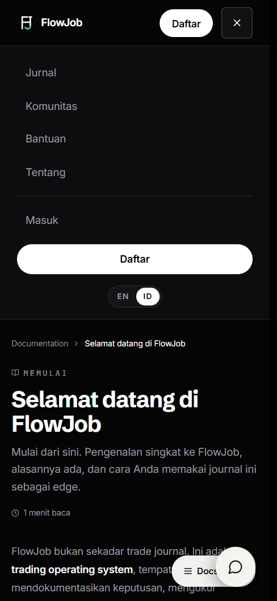

# FlowJob

**Jurnal trading untuk meninjau keputusan, dengan jalur belajar yang memberi konteks pada praktiknya.**

FlowJob dikembangkan oleh Iqbal sebagai **Founder & Solo Developer**. Produk ini menghubungkan pencatatan transaksi, rencana harian, dan evaluasi dengan pembelajaran pasar. Jurnal dasar dapat digunakan gratis; akses materi mengikuti ketentuan Bootcamp.

[**Buka FlowJob**](https://www.flowjob.id/) · [Tentang produk](https://www.flowjob.id/about) · [Panduan jurnal](https://www.flowjob.id/docs/welcome?lang=id)

*Tampilan beranda publik: visualisasi Volume Profile memperkenalkan cara membaca konteks pasar, bukan sinyal transaksi.*

## Mengapa FlowJob dibuat

Hasil sebuah transaksi tidak menceritakan proses yang menghasilkan keputusan itu. Trade yang untung bisa saja melanggar rencana; trade yang rugi bisa tetap dijalankan sesuai aturan. Ketika catatan tersebar di spreadsheet, gambar, dan ingatan, membedakan keduanya menjadi sulit.

FlowJob menempatkan rencana, transaksi, dan ulasan dalam satu alur. Tujuannya bukan memberikan sinyal atau menjanjikan profit, melainkan membantu pengguna membaca kembali apa yang mereka putuskan dan apa yang terjadi setelahnya.

## Tampilan produk

### Jalur belajar: empat sudut pandang

Beranda memperkenalkan **Pondasi, Order Flow, Options Flow, dan Makro** sebagai empat perspektif untuk membaca pasar. Diagram memberi orientasi tanpa menampilkan isi materi anggota. Angka bab pada silabus menunjukkan cakupan rencana, bukan jumlah bab yang sudah terbit. [Lihat jalur belajar](https://www.flowjob.id/?lang=id#curriculum).

### Dokumentasi: titik masuk ke jurnal

Panduan publik menghubungkan akun pencatatan, model, trade, dan Analytics. Gambar ini adalah potongan bagian atas halaman; rincian model trading tidak ditampilkan. [Buka panduan memulai](https://www.flowjob.id/docs/welcome?lang=id).

### Navigasi pada layar kecil

Menu menjaga pintu masuk jurnal, komunitas, bantuan, dan bahasa tetap tersedia pada lebar ponsel. Ketiga cuplikan diambil dari halaman publik tanpa login pada **7 November 2026 (WIB)**; tidak menggambarkan sesi anggota.

## Cara produk bekerja

**Catat konteks sebelum menilai hasil.** Akun pencatatan memisahkan aktivitas Live dan Forward Test; model mendokumentasikan aturan setup yang dipilih pengguna. Trade Journal mengaitkan transaksi dengan akun, model, risiko, dan catatan eksekusi. Daily Journal memberi tempat untuk rencana sebelum sesi dan evaluasi sesudahnya. Analytics kemudian membantu membaca pola dalam riwayat yang dicatat—bukan menentukan apakah suatu keputusan pasti benar.

Pemisahan ini disengaja: satu angka P&L tidak menggantikan alasan entry, kepatuhan pada rencana, atau kondisi saat keputusan dibuat. Semakin lengkap catatan yang diisi pengguna, semakin masuk akal ulasannya; penilaian emosi dan disiplin tetap merupakan input pengguna, bukan diagnosis otomatis. Alur ini dijelaskan dalam [panduan akun](https://www.flowjob.id/docs/getting-started/your-first-account), [trade pertama](https://www.flowjob.id/docs/getting-started/your-first-trade), [Daily Journal](https://www.flowjob.id/docs/journal/daily-entries), dan [Analytics](https://www.flowjob.id/docs/analytics/overview).

**Belajar tanpa mencampur silabus dan ketersediaan.** Jalur belajar memetakan **28 bab dalam empat pilar**, tetapi peta itu bukan katalog materi yang telah selesai. Pada **7 November 2026**, halaman [Tentang FlowJob](https://www.flowjob.id/about) menyatakan **Bab 1 dan 2 tersedia dengan akses Bootcamp; 26 bab lainnya masih direncanakan**. Materi lama tidak lagi tersedia. Status terkini selalu mengikuti website, bukan angka yang dibekukan di README ini.

Jurnal dasar Foundation tetap gratis; Bootcamp adalah pembelian terpisah untuk akses edukasi sesuai materi yang tersedia dan [ketentuan produk](https://www.flowjob.id/terms). Pengguna tidak perlu membeli Bootcamp untuk mulai mencatat trade. Layanan broker, data pasar, dan modal trading tidak termasuk dalam FlowJob.

## Keputusan pengembangan

### Menilai proses, bukan hanya hasil

Jurnal memisahkan akun, model, trade, dan catatan harian agar transaksi tidak menjadi angka untung-rugi tanpa konteks. Catatan sebelum dan sesudah sesi punya fungsi berbeda: rencana awal tidak boleh ditulis ulang seolah-olah sudah diketahui setelah melihat hasil. Struktur ini meminta lebih banyak kedisiplinan mengisi data, tetapi membuat riwayat lebih berguna untuk ditinjau.

### Memisahkan rencana kurikulum dari materi terbit

Keempat pilar perlu terlihat agar calon pembelajar memahami arah produk. Namun, tampilan silabus tidak boleh membuat bab yang direncanakan terlihat siap dibaca. Karena itu status materi dan aksesnya dijelaskan terpisah dari jumlah bab. Pembaca dapat memahami apa yang tersedia sebelum mengambil keputusan membeli.

### Menjaga batas antara edukasi dan eksekusi

Visualisasi pasar dan panduan jurnal dipakai untuk membangun proses observasi, pencatatan, dan ulasan. FlowJob tidak membuka rekening broker, mengirim order, atau memberikan sinyal. Pemisahan ini penting agar pembaca tidak menganggap sebuah diagram pasar sebagai instruksi transaksi.

## Jelajahi FlowJob

- [Beranda](https://www.flowjob.id/) — pendekatan belajar, jurnal, dan jalur materi.
- [Tentang FlowJob](https://www.flowjob.id/about) — status materi dan akses yang berlaku.
- [Dokumentasi pengguna](https://www.flowjob.id/docs/welcome?lang=id) — panduan jurnal dan penjelasan fitur.
- [Syarat dan Ketentuan](https://www.flowjob.id/terms) — ketentuan akses, pembayaran, dan batas layanan.

Repo ini adalah showcase produk, bukan source aplikasi. Cuplikan hanya berasal dari halaman publik; kode, materi anggota, konfigurasi, dan data pengguna tetap privat. Perdagangan futures dan derivatif berisiko; FlowJob bukan penyedia sinyal atau nasihat keuangan.

© 2026 FlowJob. All rights reserved.
