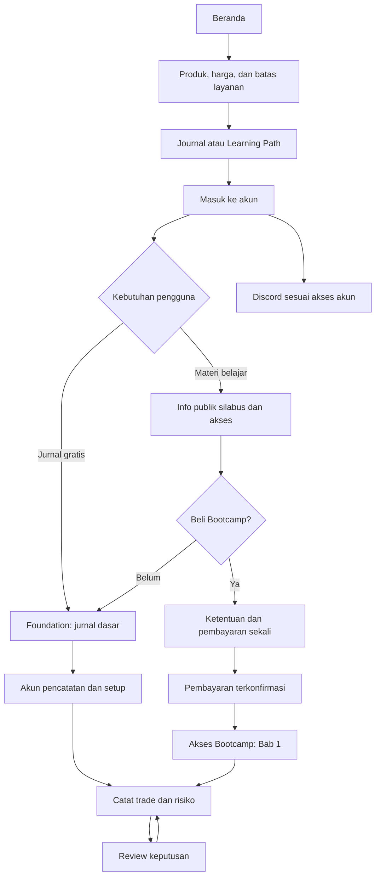

# FlowJob

**Trading Journal dan jalur belajar trading untuk pengguna Indonesia.**

[Website FlowJob](https://www.flowjob.id/)

FlowJob membantu trader mendokumentasikan keputusan, bukan mencari sinyal. Produk ini menggabungkan aplikasi jurnal berbasis web, materi edukasi dengan akses Bootcamp, dan komunitas Discord. Pengguna dapat mulai dari jurnal gratis tanpa membeli materi belajar. Lihat [Tentang FlowJob](https://www.flowjob.id/about).

Studi kasus ini membahas tujuan produk, penggunaan jurnal, pembagian akses, pengalaman belajar, dan keputusan pembelian. Informasi ketersediaan mengacu pada halaman publik yang ditinjau pada **6 November 2026**. Rincian fitur merupakan penjelasan dokumentasi pengguna, bukan hasil pengujian area anggota.

## Daftar isi

- [Tampilan beranda](#tampilan-beranda)
- [Masalah yang ingin diselesaikan](#masalah-yang-ingin-diselesaikan)
- [Kebutuhan pengguna baru dan pengguna kembali](#kebutuhan-pengguna-baru-dan-pengguna-kembali)
- [Kategori produk](#kategori-produk-aplikasi-web-bukan-lms-lengkap)
- [Modul dan alur pencatatan](#modul-dan-alur-pencatatan)
- [Membaca Analytics dengan batas yang jelas](#membaca-analytics-dengan-batas-yang-jelas)
- [Contoh ilustratif review jurnal](#contoh-ilustratif-review-jurnal)
- [Learning Path dan status materi](#learning-path-cakupan-berbeda-dari-ketersediaan)
- [Perjalanan gratis dan berbayar](#perjalanan-pengguna-gratis-dan-berbayar)
- [Status akses dan isi yang terlihat pengguna](#status-akses-dan-isi-yang-terlihat-pengguna)
- [Model penjualan dan batas pembelian](#model-penjualan-dan-batas-pembelian)
- [Pertimbangan produk](#pertimbangan-produk-dalam-studi-kasus-ini)
- [Glosarium ringkas](#glosarium-ringkas)
- [Sumber dan akses produk](#coba-produknya-dan-periksa-sumber)
- [Tentang repositori](#tentang-repositori-ini)

## Tampilan beranda

Cuplikan halaman publik tanpa login; tampilan produk dapat berubah.

## Masalah yang ingin diselesaikan

Catatan trading yang hanya berisi hasil untung atau rugi tidak menjelaskan alasan suatu keputusan. Konteks pasar, rencana awal, risiko, bukti yang digunakan, dan kondisi emosional juga diperlukan saat meninjau transaksi. FlowJob menyediakan tempat untuk menyimpan catatan tersebut agar pembelajaran tidak hanya mengandalkan ingatan setelah hasil transaksi diketahui.

Di sisi edukasi, produk mengarahkan pengguna untuk membedakan apa yang terlihat di pasar dari kesimpulan yang masih perlu diuji. Beranda menyusun prosesnya menjadi empat pertanyaan:

1. **Konteks:** bagaimana struktur, sesi, dan kondisi pasar saat itu?
2. **Lokasi:** area nilai, likuiditas, atau level mana yang perlu dievaluasi?
3. **Bukti:** apakah transaksi dan respons harga mendukung pengamatan, atau lebih baik menunggu?
4. **Ulasan:** apa risiko, kondisi pembatalan, dan pelajaran yang perlu dicatat?

Sasaran produknya adalah trader dan pembelajar mandiri yang bersedia mencatat serta mengevaluasi keputusan sendiri. FlowJob bukan pengganti pengelolaan risiko dan tidak ditujukan bagi pengguna yang menginginkan sinyal, copy trading, atau janji hasil.

Empat pertanyaan tersebut berasal dari [proses keputusan di beranda](https://www.flowjob.id/#method). Visualisasi pasar berfungsi sebagai konteks belajar, bukan instruksi membeli atau menjual.

## Kebutuhan pengguna baru dan pengguna kembali

Pembagian berikut adalah cara membaca kebutuhan produk, bukan profil pelanggan yang telah diteliti.

| Kebutuhan | Pengguna baru | Pengguna yang kembali |
| --- | --- | --- |
| Memulai pencatatan | Memahami perbedaan akun aplikasi, akun jurnal, dan model; mencatat transaksi pertama dengan konteks yang cukup. | Memastikan transaksi baru masuk ke akun dan model yang benar, bukan mengulang pengaturan awal. |
| Menjaga kualitas catatan | Membedakan hasil transaksi dari kepatuhan terhadap rencana. | Menemukan catatan yang belum lengkap, lalu melengkapi hanya informasi yang masih dapat dipastikan. |
| Membaca evaluasi | Mengenali arti P&L, R, dan drawdown sebelum menarik kesimpulan. | Membandingkan periode atau setup yang sebanding, lalu membaca kembali catatan di balik ringkasan. |
| Belajar | Memeriksa Bab 1 yang tersedia dan fungsi empat pilar. | Memeriksa perubahan status materi; tidak menganggap materi lama otomatis tersedia lagi. |

Urutan awal yang didokumentasikan adalah **buat akun pencatatan, pilih model, catat trade, lalu buka Analytics**. Pengguna kembali lebih membutuhkan pencarian, filter, dan peninjauan riwayat. Sumber: [panduan memulai](https://www.flowjob.id/docs/welcome), [pencarian dan filter](https://www.flowjob.id/docs/journal/search-and-filter).

## Kategori produk: aplikasi web, bukan LMS lengkap

**FlowJob paling tepat dijelaskan sebagai aplikasi Trading Journal berbasis web dengan komponen edukasi berbayar dan komunitas.** Dari cara penyampaiannya, jurnal memiliki karakter *Software as a Service* (SaaS): pengguna memakai layanan melalui akun di website, bukan memasang aplikasi dari repositori ini. Istilah tersebut menjelaskan bentuk layanan, bukan berarti FlowJob menjual langganan bulanan.

Learning Path memberi struktur pembelajaran dan akses ke materi yang telah diterbitkan. Namun, keberadaan katalog dan halaman baca saja tidak cukup untuk menyebut FlowJob sebagai *Learning Management System* (LMS) lengkap. Studi kasus ini tidak mengklaim adanya pengelolaan kelas/instruktur, penilaian formal, sertifikasi, atau kurikulum yang sudah seluruhnya dapat dipelajari. **Model komersial yang dinyatakan di situs adalah jurnal Foundation gratis dan Bootcamp dengan pembayaran satu kali.**

## Modul dan alur pencatatan

Jurnal memisahkan konteks harian, aturan setup, transaksi, dan ringkasan. Pembagian ini membantu pengguna menjawab pertanyaan yang berbeda tanpa menjadikan setiap catatan sebagai laporan panjang.

### Accounts: memisahkan konteks pencatatan

**Masukan:** nama akun, tipe Live atau Forward Test, saldo awal, mata uang, dan catatan opsional.
**Tindakan:** membuat akun pencatatan, memilihnya pada form trade, lalu menggunakan filter akun ketika meninjau Analytics.
**Keluaran:** riwayat dan ringkasan yang dapat dibaca dalam konteks akun tersebut, termasuk pertumbuhan terhadap saldo awal.

Ada tiga pengertian “akun” yang tidak boleh tertukar:

- **Akun FlowJob:** identitas pengguna untuk memakai aplikasi dan memperoleh akses sesuai statusnya.
- **Akun jurnal:** kelompok catatan yang diberi nama dan tipe oleh pengguna. Label Live mencatat aktivitas bermodal riil; Forward Test memisahkan catatan pengujian dengan saldo virtual.
- **Rekening broker:** tempat layanan transaksi dan dana berada, terpisah dari FlowJob. Membuat akun jurnal tidak membuka rekening broker, menyetor modal, atau menjalankan transaksi.

Saldo awal yang keliru membuat persentase pertumbuhan sulit ditafsirkan. Mengganti nama akun tidak berarti memulai riwayat baru; dokumentasi menyatakan penghapusan akun melepas pengelompokan trade tanpa menghapus trade-nya. Tampilan gabungan “House view” masih ditandai sebagai rencana, sehingga tidak disajikan sebagai fitur tersedia di sini.

Sumber: [akun pertama](https://www.flowjob.id/docs/getting-started/your-first-account), [multi-account](https://www.flowjob.id/docs/accounts/multi-account), [batas layanan](https://www.flowjob.id/terms).

### Models: menulis aturan sebelum menilai hasil

**Masukan:** nama setup, jenis pasar, timeframe, sesi, alasan entry, kondisi ideal dan pembatalan, checklist, langkah pelaksanaan, serta tag.
**Tindakan:** mendokumentasikan setup, kemudian memilih model tersebut pada trade yang sesuai.
**Keluaran:** catatan transaksi yang dapat ditinjau menurut setup, bukan hanya menurut instrumen atau hasilnya.

Model adalah dokumentasi pengguna, bukan bot atau instruksi eksekusi otomatis. Nama model yang berbeda untuk setiap transaksi akan memecah kelompok pembanding. Menurut panduan, menghapus model mempertahankan riwayat trade tetapi membuatnya tidak lagi berkategori model tersebut.

Sumber: [model pertama](https://www.flowjob.id/docs/getting-started/your-first-model). README ini tidak menyalin aturan model bawaan atau isi materi berbayar.

### Trade Journal: satu catatan untuk satu keputusan transaksi

**Masukan:** tanggal dan waktu, akun, model, instrumen, arah, harga entry, SL/TP, ukuran posisi, dan outcome.
**Tindakan:** mengisi trade, memeriksa P&L serta R-multiple, menambahkan penilaian eksekusi, catatan, dan screenshot sebelum/sesudah bila diperlukan.
**Keluaran:** riwayat transaksi yang menghubungkan hasil dengan alasan entry, risiko, dan penilaian pengguna sendiri.

Panduan menjelaskan perhitungan P&L dan R-multiple dengan pilihan koreksi manual. Grade, kualitas setup, disiplin, emosi, mistake tag, dan rule violation merupakan penilaian atau penandaan pengguna; bukan penilaian objektif otomatis atas kemampuan trader.

Catatan lama dapat dimasukkan manual dengan tanggal yang sesuai. Dokumentasi belum menyatakan impor otomatis dari platform lain tersedia. Pengisian SL/TP di jurnal juga tidak memasang order perlindungan pada broker. Penghapusan trade dijelaskan sebagai tindakan yang tidak dapat dibatalkan.

Sumber: [trade pertama](https://www.flowjob.id/docs/getting-started/your-first-trade), [FAQ jurnal](https://www.flowjob.id/docs/faq#trade-journal).

### Daily Journal: rencana dan evaluasi dalam konteks satu hari

**Masukan sebelum sesi:** market bias, planned setups, risk plan, dan kondisi emosional.
**Masukan setelah sesi:** execution notes, hal yang berjalan baik/tidak baik, lessons learned, kondisi emosional, dan skor disiplin.
**Tindakan:** memilih tanggal pada kalender, menulis rencana, lalu melengkapinya dengan evaluasi setelah sesi.
**Keluaran:** catatan harian yang dapat dibaca bersama jumlah trade dan P&L di kalender.

Trade Journal menjawab “apa yang terjadi pada transaksi ini”; Daily Journal menjawab “apa yang direncanakan dan dipelajari hari itu”. Catatan sesudah sesi tidak menggantikan bukti rencana awal. Risk plan adalah catatan pengguna, bukan pembatas otomatis atas jumlah trade atau kerugian.

Sumber: [Daily Journal](https://www.flowjob.id/docs/journal/daily-entries).

### Pencarian, salinan data, dan profil publik

- **Mencari kembali:** dokumentasi menjelaskan pencarian teks serta filter instrumen, outcome, model, dan rentang tanggal. Hasil kosong perlu dibaca bersama filter yang aktif, bukan langsung dianggap data hilang.
- **Menyimpan salinan:** panduan ekspor menjelaskan CSV, tetapi halaman pencarian masih menyebutnya “segera hadir”. Ketersediaan dan cakupan ekspor perlu diperiksa pada tampilan aktual; README ini tidak menjanjikan fungsi yang dokumentasinya belum konsisten.
- **Menjaga salinan tetap privat:** panduan ekspor memperingatkan bahwa catatan pribadi dan informasi perilaku ikut dalam file. Salinan jurnal bukan materi publik siap dibagikan.
- **Berbagi secara terpilih:** panduan Public Profile menjelaskan pengaturan terpisah untuk profil publik, P&L, trade individual, dan model. Mematikan profil publik berbeda dari menghapus akun atau riwayat jurnal.

Dokumentasi profil menyatakan notes, emosi, mistake tag, dan harga entry/SL/TP tidak ditampilkan di profil publik. Ini adalah batas tampilan yang dijelaskan produk, bukan audit keamanan dari repositori ini. Tidak ada profil atau data pelanggan yang digunakan dalam showcase.

Sumber: [pencarian/filter](https://www.flowjob.id/docs/journal/search-and-filter), [ekspor dan backup](https://www.flowjob.id/docs/journal/export-and-backup), [Public Profile](https://www.flowjob.id/docs/profile/sharing-your-journal).

## Membaca Analytics dengan batas yang jelas

**Masukan Analytics adalah catatan pengguna.** Tindakan utamanya memilih konteks akun, membaca ringkasan, lalu kembali ke trade atau catatan harian yang relevan. Keluaran bukan rekomendasi transaksi, melainkan sudut pandang terhadap riwayat yang telah dicatat.

| Bagian yang didokumentasikan | Pertanyaan review | Batas interpretasi |
| --- | --- | --- |
| Performance over time | Kapan ekuitas naik/turun, dan periode mana yang perlu dibaca ulang melalui kalender? | Kurva yang naik tidak membuktikan hasil berikutnya akan sama; periksa saldo awal dan kelengkapan catatan. |
| Market behavior | Apakah hasil berbeda menurut instrumen, arah, waktu, atau distribusi R? | Kelompok dengan jumlah dan konteks trade berbeda tidak otomatis sebanding. |
| Your trading systems | Bagaimana catatan tiap model dan akun berbeda? | Hasil Forward Test tidak sama dengan hasil modal riil; pengelompokan model yang tidak konsisten mengaburkan perbandingan. |
| Mind game | Bagaimana catatan emosi, kesalahan, kualitas setup, dan disiplin berkaitan dengan hasil? | Hubungan pada riwayat bukan bukti sebab-akibat; tag yang kosong membatasi evaluasi. |
| Risk & statistics | Bagaimana metrik risiko dan simulasi menggambarkan data yang dimasukkan? | Kelly, risk of ruin, dan Monte Carlo bergantung pada asumsi; bukan instruksi ukuran posisi atau kepastian masa depan. |
| Trend analysis | Bagaimana win rate dan expectancy bergerak pada jendela trade terakhir? | Perubahan jangka pendek dapat dipengaruhi sedikit observasi atau satu hasil ekstrem. |

Sumber fitur: [Analytics overview](https://www.flowjob.id/docs/analytics/overview). Panduan [risk metrics](https://www.flowjob.id/docs/analytics/risk-metrics) juga mengakui keterbatasan asumsi simulasi. Catatan interpretasi di atas adalah kehati-hatian membaca data, bukan hasil riset performa FlowJob.

README ini tidak menetapkan jumlah trade tertentu sebagai jaminan signifikansi statistik, tidak menyalin rekomendasi alokasi modal, dan tidak mengubah metrik menjadi janji profit. Nilai review bergantung pada kejujuran, kelengkapan, dan konsistensi pencatatan.

## Contoh ilustratif review jurnal

**Skenario rekaan untuk menjelaskan cara memakai modul, bukan pengalaman pelanggan, hasil pengujian produk, atau rekomendasi trading.** Tidak ada angka keuntungan atau aturan setup berbayar yang digunakan.

Seorang pembelajar ingin meninjau apakah ia mengikuti rencananya selama latihan. Ia menggunakan satu akun pencatatan Forward Test dan satu model buatan sendiri agar latihan tidak tercampur dengan catatan Live.

1. **Sebelum sesi:** pada Daily Journal, ia menulis konteks pasar, setup yang ingin diamati, batas risiko pilihannya, dan kondisi emosional. Ia mencatat apa yang akan membuat rencananya tidak berlaku.
2. **Saat mencatat transaksi latihan:** ia memilih akun dan model yang benar, mengisi rincian transaksi, lalu menambahkan alasan entry dan screenshot yang relevan.
3. **Sesudah sesi:** ia membandingkan tindakan dengan rencana. Dalam skenario ini, satu transaksi berakhir untung tetapi melanggar aturan pribadinya; transaksi lain rugi meskipun mengikuti rencana.
4. **Saat review:** ia memakai rentang tanggal dan model untuk menemukan kembali trade, membaca catatan, lalu membandingkannya dengan ringkasan akun di Analytics. Ia tidak menganggap hasil untung sebagai bukti eksekusi yang baik.
5. **Kesimpulan yang ditulis sendiri:** “Hasil transaksi dan kepatuhan perlu dinilai terpisah. Pada latihan berikutnya, saya akan mencatat alasan penyimpangan saat masih ingat.” Ini masuk ke lessons learned, bukan keluaran nasihat otomatis dari aplikasi.

Contoh ini memakai tindakan yang dijelaskan dalam [Daily Journal](https://www.flowjob.id/docs/journal/daily-entries), [form trade](https://www.flowjob.id/docs/getting-started/your-first-trade), dan [filter jurnal](https://www.flowjob.id/docs/journal/search-and-filter). Tidak mengandaikan deteksi emosi otomatis, penilaian AI, pengiriman order, atau sinkronisasi broker.

## Learning Path: cakupan berbeda dari ketersediaan

Silabus terdiri dari **28 bab dalam empat pilar**. Jumlah tersebut menunjukkan cakupan yang direncanakan, bukan jumlah pelajaran yang sudah dapat dibuka. Berikut fungsi tiap pilar pada tingkat pengenalan, tanpa menyalin isi pengajaran.

| Pilar | Bab silabus | Peran dalam proses belajar | Batas yang perlu dijaga |
| --- | ---: | --- | --- |
| **Pondasi** | 6 | Memahami instrumen, tempat bertransaksi, risiko, dan informasi dasar chart sebelum menafsirkan aktivitas pasar. | Mengenal istilah dan mekanisme tidak sama dengan siap mengambil risiko modal riil. |
| **Order Flow** | 9 | Menghubungkan transaksi, likuiditas, dan respons harga; menilai bukti terhadap konteks yang sudah ditentukan. | Satu pola transaksi tidak otomatis menjadi sinyal entry. |
| **Options Flow** | 7 | Memahami kontrak options, perubahan risiko, dan perbedaan informasi volume dengan posisi terbuka. | Volume atau open interest saja tidak menetapkan arah pasar. |
| **Makro** | 6 | Menempatkan data ekonomi, ekspektasi, dan kebijakan dalam respons lintas pasar. | Rilis data tidak memiliki satu arah respons yang selalu berlaku. |

Keempatnya saling melengkapi: memahami objek yang diamati, membaca aktivitas, mengenali batas informasi options, lalu menempatkannya dalam konteks ekonomi. Sumber: [Learning Path di beranda](https://www.flowjob.id/).

### Status materi pada 6 November 2026

- **Bab 1, “Mengenal Pasar dan Cara Kerjanya”, sudah tersedia dengan akses Bootcamp.** Bab ini menjadi titik mulai, bukan bukti seluruh jalur sudah diterbitkan.
- **Bab 2–28 masih direncanakan.** Keberadaannya di silabus tidak berarti tersedia untuk dibaca atau memiliki tanggal rilis yang dijanjikan di README ini.
- **Materi lama tidak lagi tersedia.** Jangan menyamakan status pembelian Bootcamp dengan akses ke seluruh materi historis; hak terkait pembelian sebelumnya tetap mengikuti ketentuan.
- **Trading Journal tetap dapat digunakan**, termasuk akses dasar gratis melalui Foundation.

Status tersebut mengikuti [halaman Tentang FlowJob](https://www.flowjob.id/about), yang secara eksplisit menyatakan Bab 1 tersedia dan 27 bab masih direncanakan. Rincian terkini tetap mengikuti website.

Katalog dan reader berada di area akun. Ketersediaan Bab 1 di sini mengikuti pengumuman publik produk, bukan pemeriksaan isi materi berbayar. [FAQ](https://www.flowjob.id/docs/faq) masih memuat keterangan lama bahwa materi pengganti belum tersedia; untuk ringkasan status saat peninjauan, README ini mengikuti informasi eksplisit di halaman Tentang dan beranda.

## Perjalanan pengguna gratis dan berbayar

Diagram berikut menunjukkan dari mana pengguna masuk, kapan jalurnya bercabang, dan ke mana masing-masing pilihan mengarah. Ini adalah alur produk, bukan jaminan urutan layar checkout yang selalu sama.

**Jalur gratis mempunyai kegunaan sendiri.** Foundation menyediakan jurnal dasar untuk membangun kebiasaan pencatatan. “Akun pencatatan” pada diagram adalah pengelompokan transaksi di jurnal, bukan pembukaan rekening broker. Pembelian Bootcamp bukan syarat untuk mulai menggunakan jurnal dasar.

**Jalur berbayar memerlukan keputusan berdasarkan materi yang benar-benar tersedia.** Pengguna perlu membedakan 28 bab silabus dari Bab 1 yang sudah terbit. Bootcamp memberi akses edukasi sesuai ketentuan pembelian, bukan janji bahwa seluruh bab telah selesai. Komunitas ditampilkan sebagai jalur dari akun karena halaman publik menyebut aksesnya mengikuti akun, bukan sebagai manfaat yang hanya dapat diperoleh lewat pembayaran.

Diagram merangkum halaman publik dan dokumentasi pengguna. Penyusunan studi kasus tidak melakukan login, membuat pesanan, memulai pembayaran, atau membuka materi berbayar; urutan layar transaksi tidak diklaim telah diuji.

## Status akses dan isi yang terlihat pengguna

Status akses, publikasi materi, dan keberadaan catatan menjawab pertanyaan yang berbeda. Tidak semuanya berarti “fitur terkunci”.

| Keadaan | Arti bagi pengguna | Langkah yang relevan |
| --- | --- | --- |
| Belum masuk ke akun | Informasi produk dan dokumentasi dapat dipelajari sebelum memakai area akun. | Tentukan kebutuhan jurnal atau edukasi terlebih dahulu. |
| Foundation | Jurnal dasar tersedia gratis; bukan status pembelian Bootcamp. | Mulai dari akun pencatatan dan trade pertama. |
| Bootcamp | Akses edukasi mengikuti status produk dan ketentuan pembelian. | Periksa materi yang tersedia, bukan hanya jumlah bab silabus. |
| Bab tersedia, direncanakan, atau materi lama dihapus | Ketiganya memiliki arti berbeda meskipun terkait jalur belajar yang sama. | Bedakan Bab 1, 27 bab rencana, dan materi historis yang tidak tersedia. |
| Daftar trade tampak kosong | Bisa belum ada catatan atau filter tidak mencakup catatan yang dicari. | Periksa rentang tanggal dan filter sebelum menyimpulkan data hilang. |
| Bagian perilaku belum terisi | Ringkasan emosi/kesalahan membutuhkan informasi yang dicatat pengguna. | Lengkapi hanya informasi yang diketahui; jangan mengarang tag agar grafik terisi. |
| Profil publik dinonaktifkan | Halaman publik tidak tersedia, tanpa berarti jurnal pribadi dihapus. | Periksa pengaturan berbagi jika memang ingin menerbitkan profil. |
| Upload gagal atau Analytics terus memuat | Hambatan penggunaan, bukan hasil analisis atau konfirmasi penyimpanan. | Periksa format/ukuran gambar atau koneksi, muat ulang, lalu hubungi bantuan bila berlanjut. |

Sumber: [akses dan materi](https://www.flowjob.id/about), [ketentuan akun](https://www.flowjob.id/terms), [troubleshooting](https://www.flowjob.id/docs/general/troubleshooting), [pengaturan profil](https://www.flowjob.id/docs/profile/sharing-your-journal). Tabel ini menjelaskan keadaan yang didokumentasikan, bukan inventaris layar hasil login.

## Model penjualan dan batas pembelian

**FlowJob memisahkan utilitas gratis dari akses edukasi berbayar.** Foundation memberi akses jurnal dasar, sementara Bootcamp dijual langsung melalui website sebagai produk edukasi dengan pembayaran satu kali. Ini bukan model langganan SaaS bulanan, dan istilah “Bootcamp” tidak digunakan di sini untuk menjanjikan kelas live atau jadwal cohort.

- **Harga yang ditampilkan saat peninjauan:** Rp3.500.000 untuk Bootcamp. Harga, promosi, pajak bila ada, dan ketentuan aktual tetap mengikuti informasi saat pembelian.
- **Yang harus diperiksa sebelum membeli:** status materi, hak akses, dan ketentuan penggunaan. Situs mengarahkan calon pembeli memeriksa rincian tersebut sebelum memilih Bootcamp.
- **Biaya di luar produk:** layanan broker, data pasar, platform pihak ketiga, dan modal trading terpisah dari harga Bootcamp.
- **Refund bersyarat:** batas waktu, syarat penggunaan materi, dan prosedur pengajuan mengikuti [Syarat dan Ketentuan](https://www.flowjob.id/terms). Status pembayaran saja tidak menjamin kelayakan refund; jangan menafsirkan jumlah bab rencana sebagai ukuran materi yang sudah digunakan.
- **Pengajuan bukan persetujuan otomatis:** verifikasi identitas/transaksi dan metode pengembalian tetap diperlukan; biaya pihak ketiga serta ketentuan hukum dapat berlaku. Hak konsumen yang tidak dapat dikesampingkan tetap berlaku.
- **Pembelian sebelumnya:** perubahan atau penghapusan materi tidak menghapus hak yang timbul dari pembelian terdahulu. Pertanyaan akses dan transaksi lama diarahkan ke [support FlowJob](mailto:support@flowjob.id).

### Menilai kecocokan sebelum membeli

1. **Jika kebutuhan utama adalah pencatatan:** mulai dari Foundation; tidak perlu membeli edukasi untuk mulai memakai jurnal dasar.
2. **Jika kebutuhan utama adalah belajar terstruktur:** nilai Bab 1 yang tersedia, susunan pilar, dan ketentuan akses, bukan mengasumsikan 28 bab sudah lengkap.
3. **Jika membutuhkan semua materi sekarang atau jadwal kelas tertentu:** jangan menyimpulkannya dari nama Bootcamp. README ini tidak menjanjikan kelas live, cohort, sertifikasi, pendampingan pribadi, atau tanggal selesai silabus.
4. **Jika membutuhkan sinyal, bot, copy trading, atau pengelolaan dana:** layanan tersebut secara eksplisit berada di luar penawaran FlowJob.

Sumber komersial: [harga dan biaya terpisah di beranda](https://www.flowjob.id/), [status materi](https://www.flowjob.id/about), [Syarat dan Ketentuan](https://www.flowjob.id/terms). Harga dan hak aktual tetap mengikuti informasi pembelian, bukan salinan README.

Model ini memberi dua keputusan yang terpisah: apakah jurnal cocok untuk kebiasaan pencatatan, dan apakah edukasi yang tersedia layak dibeli untuk kebutuhan pengguna. Tidak ada angka penjualan, konversi, pelanggan, atau hasil trading yang digunakan sebagai bukti keberhasilan produk.

## Pertimbangan produk dalam studi kasus ini

**Memisahkan silabus dari materi terbit.** Katalog perlu menjelaskan arah belajar tanpa membuat daftar rencana terlihat seperti inventaris kursus yang sudah selesai. Status Bab 1 dan Bab 2–28 menjadi informasi penting untuk keputusan pembelian, bukan catatan kecil setelah checkout.

**Menghubungkan pembelajaran dengan catatan keputusan.** Jurnal memberi ruang untuk mencatat konteks, bukti, risiko, dan evaluasi. Dengan demikian, edukasi tidak hanya dipresentasikan sebagai konsumsi materi, tetapi dikaitkan dengan kebiasaan meninjau keputusan sendiri. Ini adalah tujuan pengalaman produk, bukan klaim peningkatan profit yang telah diukur.

**Membedakan layanan aplikasi dari model pembayaran.** Bentuknya aplikasi web berbasis akun, tetapi penawaran berbayarnya adalah Bootcamp satu kali bayar. Menuliskan keduanya secara terpisah mencegah calon pengguna mengira ada langganan jurnal wajib atau platform LMS lengkap.

**Menempatkan batas layanan sebelum pembelian.** Produk menjelaskan bahwa broker, data pasar, dan modal bukan bagian dari pembelian. Penegasan bahwa FlowJob bukan penyedia sinyal juga menjaga agar visualisasi pasar dan materi edukasi tidak dianggap sebagai instruksi transaksi.

## Glosarium ringkas

| Istilah | Arti dalam pembahasan ini |
| --- | --- |
| **Setup / model** | Dokumentasi kondisi dan aturan keputusan yang digunakan untuk mengelompokkan trade. Bukan model AI atau bot trading. |
| **P&L** | Profit and loss, hasil untung/rugi yang dicatat. Berbeda dari penilaian kualitas keputusan. |
| **R-multiple** | Hasil transaksi dinyatakan terhadap unit risiko awal; pembacaannya bergantung pada data risiko yang benar. |
| **Win rate** | Proporsi trade menang; tidak menjelaskan besarnya keuntungan atau kerugian dengan sendirinya. |
| **Drawdown** | Penurunan dari puncak nilai ekuitas pada riwayat yang ditinjau. |
| **Expectancy** | Rata-rata hasil yang diperkirakan dari distribusi hasil tercatat, bukan kepastian hasil trade berikutnya. |
| **Forward Test** | Pengujian dengan pengamatan pasar berjalan dan saldo virtual, dipisahkan dari pencatatan modal riil. |
| **Rule violation** | Penanda pengguna bahwa tindakannya menyimpang dari aturan sendiri; bukan bukti pelanggaran yang dideteksi otomatis. |
| **Silabus** | Peta cakupan pembelajaran; berbeda dari daftar materi terbit dan hak akses membacanya. |

Rujukan istilah produk: [panduan trade](https://www.flowjob.id/docs/getting-started/your-first-trade), [akun](https://www.flowjob.id/docs/getting-started/your-first-account), dan [Analytics](https://www.flowjob.id/docs/analytics/overview).

## Coba produknya dan periksa sumber

- [Beranda FlowJob](https://www.flowjob.id/): pendekatan pembacaan pasar, empat pilar, dan harga yang ditampilkan.
- [Tentang FlowJob](https://www.flowjob.id/about): jurnal gratis, komunitas, dan status publikasi materi.
- [Trading Journal](https://www.flowjob.id/dashboard/journal): pintu masuk fitur jurnal; memerlukan akun.
- [Learning Path](https://www.flowjob.id/dashboard/kurikulum): katalog silabus dan rincian akses; pengunjung tanpa sesi diarahkan untuk masuk.
- [Dokumentasi pengguna](https://www.flowjob.id/docs/welcome): penjelasan fitur serta panduan pencatatan dan evaluasi.
- [Syarat dan Ketentuan](https://www.flowjob.id/terms): akses Foundation/Bootcamp, pembayaran satu kali, refund, dan tanggung jawab pengguna.

Halaman publik dapat berubah dan dokumentasi lama dapat tertinggal dari pembaruan produk. Periksa kembali informasi akses, materi, serta ketentuan pembelian di website. FlowJob bukan layanan sinyal maupun nasihat keuangan; perdagangan futures dan derivatif memiliki risiko kerugian yang signifikan.

## Tentang repositori ini

Repositori ini hanya berisi dokumentasi portofolio dan screenshot halaman publik. Source code, API internal, skema database, credential, konfigurasi deployment, mekanisme sesi, data pengguna, riwayat pengembangan, dan materi berbayar tidak dipublikasikan. Tidak ada instruksi menjalankan atau membangun ulang aplikasi dari repositori ini.

© 2026 FlowJob. All rights reserved.
