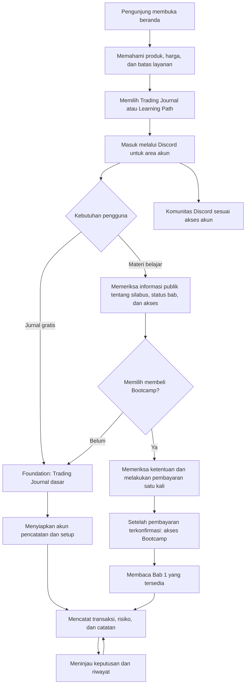

# FlowJob

**Trading Journal dan jalur belajar trading untuk pengguna Indonesia.**

[Website FlowJob](https://www.flowjob.id/)

FlowJob membantu trader mendokumentasikan keputusan, bukan mencari sinyal. Produk ini menggabungkan aplikasi jurnal berbasis web, materi edukasi dengan akses Bootcamp, dan komunitas Discord. Pengguna dapat mulai dari jurnal gratis tanpa membeli materi belajar.

Studi kasus ini membahas tujuan produk, pembagian akses, pengalaman pengguna, dan model penjualannya. Informasi ketersediaan mengacu pada halaman publik yang ditinjau pada **6 November 2026**, bukan pada anggapan bahwa seluruh silabus sudah selesai.

## Tampilan beranda

Cuplikan halaman publik tanpa login; tampilan produk dapat berubah.

## Masalah yang ingin diselesaikan

Catatan trading yang hanya berisi hasil untung atau rugi tidak menjelaskan alasan suatu keputusan. Konteks pasar, rencana awal, risiko, bukti yang digunakan, dan kondisi emosional juga diperlukan saat meninjau transaksi. FlowJob menyediakan tempat untuk menyimpan catatan tersebut agar pembelajaran tidak hanya mengandalkan ingatan setelah hasil transaksi diketahui.

Di sisi edukasi, produk mengarahkan pengguna untuk membedakan apa yang terlihat di pasar dari kesimpulan yang masih perlu diuji. Beranda menyusun prosesnya menjadi empat pertanyaan:

1. **Konteks:** bagaimana struktur, sesi, dan kondisi pasar saat itu?
2. **Lokasi:** area nilai, likuiditas, atau level mana yang perlu dievaluasi?
3. **Bukti:** apakah transaksi dan respons harga mendukung pengamatan, atau lebih baik menunggu?
4. **Ulasan:** apa risiko, kondisi pembatalan, dan pelajaran yang perlu dicatat?

Sasaran produknya adalah trader dan pembelajar mandiri yang bersedia mencatat serta mengevaluasi keputusan sendiri. FlowJob bukan pengganti pengelolaan risiko dan tidak ditujukan bagi pengguna yang menginginkan sinyal, copy trading, atau janji hasil.

## Kategori produk: aplikasi web, bukan LMS lengkap

**FlowJob paling tepat dijelaskan sebagai aplikasi Trading Journal berbasis web dengan komponen edukasi berbayar dan komunitas.** Dari cara penyampaiannya, jurnal memiliki karakter *Software as a Service* (SaaS): pengguna memakai layanan melalui akun di website, bukan memasang aplikasi dari repositori ini. Istilah tersebut menjelaskan bentuk layanan, bukan berarti FlowJob menjual langganan bulanan.

Learning Path memberi struktur pembelajaran dan akses ke materi yang telah diterbitkan. Namun, keberadaan katalog dan halaman baca saja tidak cukup untuk menyebut FlowJob sebagai *Learning Management System* (LMS) lengkap. Studi kasus ini tidak mengklaim adanya pengelolaan kelas/instruktur, penilaian formal, sertifikasi, atau kurikulum yang sudah seluruhnya dapat dipelajari. **Model komersial yang dinyatakan di situs adalah jurnal Foundation gratis dan Bootcamp dengan pembayaran satu kali.**

## Isi produk dan kegunaannya

| Bagian | Kegunaan bagi pengguna | Batas penjelasan |
| --- | --- | --- |
| **Trading Journal** | Mencatat instrumen, arah transaksi, risiko, ukuran posisi, hasil, catatan, dan screenshot untuk ditinjau kembali. | Akses jurnal dasar tersedia gratis melalui Foundation; bukan layanan eksekusi transaksi. |
| **Daily Journal** | Menyimpan pandangan pasar, rencana setup, kondisi emosional, dan evaluasi setelah sesi. | Fitur dijelaskan dalam dokumentasi publik; bukan prediksi pasar. |
| **Models dan Accounts** | Mendokumentasikan setup serta memisahkan catatan akun live dari forward test. | “Akun” di sini adalah pengelompokan catatan jurnal, bukan rekening broker atau penitipan dana. |
| **Analytics** | Meninjau riwayat melalui kurva ekuitas, distribusi R, serta pengelompokan kinerja menurut setup, waktu, dan emosi. | Ringkasan bergantung pada data yang dicatat; bukan bukti bahwa suatu strategi akan menghasilkan profit. |
| **Learning Path** | Menunjukkan urutan dan cakupan silabus dalam empat pilar. | Daftar bab adalah peta pembelajaran, bukan pernyataan semua materi telah terbit. |
| **Materi Bootcamp** | Membaca materi yang sudah tersedia sesuai hak akses akun. | Bab 1 tersedia; Bab 2–28 masih direncanakan pada tanggal peninjauan. |
| **Komunitas dan dokumentasi** | Mengakses diskusi Discord serta panduan penggunaan akun dan jurnal. | Akses komunitas mengikuti akun; tidak dinyatakan sebagai layanan pendampingan pribadi atau sinyal. |

Rincian jurnal di atas bersumber dari [dokumentasi publik FlowJob](https://www.flowjob.id/docs/welcome). Penjelasan ini tidak memperluas klaim “jurnal dasar gratis” menjadi janji bahwa setiap fitur selalu tersedia pada semua jenis akun.

## Learning Path: cakupan berbeda dari ketersediaan

Silabus terdiri dari **28 bab dalam empat pilar**. Metadata silabus tersedia dalam bahasa Indonesia dan Inggris. Jumlah bab menunjukkan cakupan yang direncanakan, bukan jumlah pelajaran yang sudah dapat dibuka.

| Pilar | Jumlah bab silabus | Fokus pembelajaran |
| --- | ---: | --- |
| **Pondasi** | 6 | Mengenali pasar, tempat bertransaksi, risiko, serta informasi dasar pada chart sebelum membaca aktivitas transaksi. |
| **Order Flow** | 9 | Membaca transaksi, likuiditas, dan respons harga tanpa memperlakukan setiap pola sebagai sinyal. |
| **Options Flow** | 7 | Memahami kontrak options, perubahan risiko, serta batas penggunaan aktivitas options sebagai konteks pasar. |
| **Makro** | 6 | Menghubungkan data ekonomi, ekspektasi, kebijakan, dan respons pasar tanpa mengubahnya menjadi ramalan arah. |

### Status materi pada 6 November 2026

- **Bab 1, “Mengenal Pasar dan Cara Kerjanya”, sudah tersedia dengan akses Bootcamp.** Cakupannya memperkenalkan produk dan futures bursa, pelaku pasar, sumber harga, transaksi, order flow, posisi, masa berlaku kontrak, dan contoh pembacaan terpandu.
- **Bab 2–28 masih direncanakan.** Keberadaannya di silabus tidak berarti tersedia untuk dibaca atau memiliki tanggal rilis yang dijanjikan di README ini.
- **Materi lama tidak lagi tersedia.** Jangan menyamakan status pembelian Bootcamp dengan akses ke seluruh materi historis.
- **Trading Journal tetap dapat digunakan**, termasuk akses dasar gratis melalui Foundation.

Status tersebut mengikuti [halaman Tentang FlowJob](https://www.flowjob.id/about), yang secara eksplisit menyatakan Bab 1 tersedia dan 27 bab masih direncanakan. Rincian terkini tetap mengikuti website.

Katalog dan reader berada di area akun. Saat ditinjau tanpa login, tautan katalog mengarah ke halaman masuk. Ketersediaan Bab 1 di sini adalah informasi yang diumumkan produk dan didukung pembaruan dokumentasinya, bukan klaim bahwa seluruh pengalaman belajar anggota telah diuji dari repositori showcase ini.

## Perjalanan pengguna gratis dan berbayar

Diagram berikut menunjukkan dari mana pengguna masuk, kapan jalurnya bercabang, dan ke mana masing-masing pilihan mengarah. Ini adalah alur produk, bukan jaminan urutan layar checkout yang selalu sama.

**Jalur gratis mempunyai kegunaan sendiri.** Foundation menyediakan jurnal dasar untuk membangun kebiasaan pencatatan. “Akun pencatatan” pada diagram adalah pengelompokan transaksi di jurnal, bukan pembukaan rekening broker. Pembelian Bootcamp bukan syarat untuk mulai menggunakan jurnal dasar.

**Jalur berbayar memerlukan keputusan berdasarkan materi yang benar-benar tersedia.** Pengguna perlu membedakan 28 bab silabus dari Bab 1 yang sudah terbit. Bootcamp memberi akses edukasi sesuai ketentuan pembelian, bukan janji bahwa seluruh bab telah selesai. Komunitas ditampilkan sebagai jalur dari akun karena halaman publik menyebut aksesnya mengikuti akun, bukan sebagai manfaat yang hanya dapat diperoleh lewat pembayaran.

Alur ini bersumber dari halaman publik dan dokumentasi pengguna. Penyusunan studi kasus tidak melakukan login, membuat pesanan, memulai pembayaran, atau membuka materi berbayar. Checkout publik hanya menampilkan status loading pada pembacaan tanpa sesi; urutan layar transaksi tidak diklaim telah diamati.

## Model penjualan dan batas pembelian

**FlowJob memisahkan utilitas gratis dari akses edukasi berbayar.** Foundation memberi akses jurnal dasar, sementara Bootcamp dijual langsung melalui website sebagai produk edukasi dengan pembayaran satu kali. Ini bukan model langganan SaaS bulanan, dan istilah “Bootcamp” tidak digunakan di sini untuk menjanjikan kelas live atau jadwal cohort.

- **Harga yang ditampilkan saat peninjauan:** Rp3.500.000 untuk Bootcamp. Harga, promosi, pajak bila ada, dan ketentuan aktual tetap mengikuti informasi saat pembelian.
- **Yang harus diperiksa sebelum membeli:** status materi, hak akses, dan ketentuan penggunaan. Situs mengarahkan calon pembeli memeriksa rincian tersebut sebelum memilih Bootcamp.
- **Biaya di luar produk:** layanan broker, data pasar, platform pihak ketiga, dan modal trading terpisah dari harga Bootcamp.
- **Refund bersyarat:** kebijakan pengajuan dan kelayakan refund mengikuti [Syarat dan Ketentuan](https://www.flowjob.id/terms). Pembelian tidak berarti refund otomatis tanpa syarat.

Model tersebut memungkinkan pengguna menilai kebutuhan jurnal terlebih dahulu tanpa pembayaran, lalu memutuskan secara terpisah apakah akses edukasi yang tersedia sesuai kebutuhannya. README ini tidak menyajikan angka penjualan, jumlah pelanggan, tingkat konversi, atau hasil trading sebagai bukti keberhasilan produk.

## Pertimbangan produk dalam studi kasus ini

**Memisahkan silabus dari materi terbit.** Katalog perlu menjelaskan arah belajar tanpa membuat daftar rencana terlihat seperti inventaris kursus yang sudah selesai. Status Bab 1 dan Bab 2–28 menjadi informasi penting untuk keputusan pembelian, bukan catatan kecil setelah checkout.

**Menghubungkan pembelajaran dengan catatan keputusan.** Jurnal memberi ruang untuk mencatat konteks, bukti, risiko, dan evaluasi. Dengan demikian, edukasi tidak hanya dipresentasikan sebagai konsumsi materi, tetapi dikaitkan dengan kebiasaan meninjau keputusan sendiri. Ini adalah tujuan pengalaman produk, bukan klaim peningkatan profit yang telah diukur.

**Membedakan layanan aplikasi dari model pembayaran.** Bentuknya aplikasi web berbasis akun, tetapi penawaran berbayarnya adalah Bootcamp satu kali bayar. Menuliskan keduanya secara terpisah mencegah calon pengguna mengira ada langganan jurnal wajib atau platform LMS lengkap.

**Menempatkan batas layanan sebelum pembelian.** Produk menjelaskan bahwa broker, data pasar, dan modal bukan bagian dari pembelian. Penegasan bahwa FlowJob bukan penyedia sinyal juga menjaga agar visualisasi pasar dan materi edukasi tidak dianggap sebagai instruksi transaksi.

## Coba produknya dan periksa sumber

- [Beranda FlowJob](https://www.flowjob.id/): pendekatan pembacaan pasar, empat pilar, dan harga yang ditampilkan.
- [Tentang FlowJob](https://www.flowjob.id/about): jurnal gratis, komunitas, dan status publikasi materi.
- [Trading Journal](https://www.flowjob.id/dashboard/journal): pintu masuk fitur jurnal; memerlukan akun.
- [Learning Path](https://www.flowjob.id/dashboard/kurikulum): katalog silabus dan rincian akses; pengunjung tanpa sesi diarahkan untuk masuk.
- [Dokumentasi pengguna](https://www.flowjob.id/docs/welcome): penjelasan fitur serta panduan pencatatan dan evaluasi.
- [Syarat dan Ketentuan](https://www.flowjob.id/terms): akses Foundation/Bootcamp, pembayaran satu kali, refund, dan tanggung jawab pengguna.

Halaman publik dapat berubah dan dokumentasi lama dapat tertinggal dari pembaruan produk. Periksa kembali informasi akses, materi, serta ketentuan pembelian di website. FlowJob bukan layanan sinyal maupun nasihat keuangan; perdagangan futures dan derivatif memiliki risiko kerugian yang signifikan.

## Tentang repositori ini

Repositori ini hanya berisi dokumentasi portofolio dan screenshot halaman publik. Source code aplikasi, konfigurasi deployment, data pengguna, credential, dan riwayat pengembangan internal tidak dipublikasikan. Tidak ada instruksi menjalankan aplikasi dari repositori ini.

© 2026 FlowJob. All rights reserved.
