# FlowJob

**Bootcamp edukasi futures dengan Trading Journal untuk mencatat dan meninjau keputusan.**

FlowJob membantu pembelajar memahami apa yang diperdagangkan, bagaimana transaksi terbentuk, dan cara menilai bukti sebelum mengambil keputusan. Bootcamp menyusun pembelajaran melalui empat pilar; Trading Journal memberi tempat untuk mendokumentasikan rencana, transaksi, dan evaluasi. Keduanya saling melengkapi, tetapi jurnal dasar dapat digunakan tanpa membeli Bootcamp.

Saya membangun FlowJob sebagai **Founder & Solo Developer**, dari arah produk dan struktur pembelajaran hingga pengalaman aplikasi berbasis akun.

[Kunjungi FlowJob](https://www.flowjob.id/) · [Lihat jalur belajar](https://www.flowjob.id/?lang=id#curriculum) · [Baca panduan jurnal](https://www.flowjob.id/docs/welcome?lang=id)

## Mengapa FlowJob ada

Grafik menunjukkan hasil pergerakan harga, tetapi tidak selalu menjelaskan transaksi di baliknya. Sebaliknya, catatan untung-rugi tidak menjelaskan apakah sebuah keputusan dibuat dengan alasan yang dapat dipertanggungjawabkan. FlowJob menyatukan dua kebutuhan yang sering terpisah: **belajar membaca konteks pasar** dan **meninjau keputusan sendiri secara terstruktur**.

Pendekatannya berangkat dari empat pertanyaan: apa konteks pasar, di mana area yang relevan, bukti apa yang terlihat pada transaksi dan respons harga, serta apa yang perlu dicatat setelah keputusan dibuat. Ini kerangka belajar dan evaluasi, bukan metode pemberian sinyal.

## Apa yang ditawarkan

### Bootcamp: belajar membaca pasar

Kurikulum Bootcamp dirancang dalam empat pilar yang menghubungkan dasar pasar dengan pembacaan transaksi dan konteks yang lebih luas:

| Pilar | Pertanyaan yang dijawab |
| --- | --- |
| **Pondasi** | Apa yang diperdagangkan, di mana transaksi terjadi, dan risiko apa yang perlu dipahami? |
| **Order Flow** | Apa yang dapat dibaca dari transaksi, likuiditas, dan respons harga? |
| **Options Flow** | Bagaimana aktivitas options dibaca sebagai konteks tanpa menyimpulkan arah dari satu angka? |
| **Makro** | Bagaimana data ekonomi, ekspektasi, dan kebijakan berkaitan dengan respons antarpasar? |

Bootcamp menyusun pembelajaran dari pengenalan instrumen dan mekanisme pasar menuju pembacaan aktivitas transaksi, options, dan makro. Visual di atas menunjukkan struktur kurikulum, bukan instruksi untuk membuka posisi. Materi belajar menjadi kerangka untuk menyusun pengamatan sendiri sebelum meninjau praktik di Trading Journal.

Bootcamp dibeli **sekali bayar**; harga dan ketentuan mengikuti website saat pembelian. Broker, data pasar, platform pihak ketiga, dan modal trading tidak termasuk dalam produk edukasi ini.

### Trading Journal: menilai praktik sendiri

**Foundation** memberi akses gratis ke jurnal dasar. Pengguna dapat memisahkan catatan Live dan Forward Test melalui akun pencatatan, menulis aturan setup pada Model, mencatat trade beserta risiko dan alasan eksekusinya, lalu menulis rencana dan evaluasi harian. Analytics membantu membaca pola dari riwayat yang diisi pengguna; ia tidak memutuskan apakah sebuah trade layak diambil.

Jurnal adalah alat pencatatan, **bukan rekening broker**: membuat akun pencatatan tidak membuka rekening transaksi atau mengirim order. Rincian alurnya ada di [panduan akun](https://www.flowjob.id/docs/getting-started/your-first-account), [trade pertama](https://www.flowjob.id/docs/getting-started/your-first-trade), dan [Analytics](https://www.flowjob.id/docs/analytics/overview).

## Perjalanan pengguna

Diagram ini mengikuti dua pintu masuk produk: Bootcamp untuk belajar membaca pasar dan Foundation untuk mencatat praktik. Keduanya dapat digunakan sebagai satu proses, tetapi jurnal tidak mewajibkan pembelian Bootcamp. Cabang “tidak ada trade” menunjukkan bahwa evaluasi sesi tetap berguna tanpa memaksakan transaksi.

```mermaid
flowchart TD
    A[Kenali metode FlowJob di beranda] --> B{Kebutuhan utama?}
    B -->|Belajar| C[Lihat empat pilar dan silabus]
    B -->|Mencatat| D[Pelajari fitur Trading Journal]
    C --> E[Periksa penawaran dan ketentuan Bootcamp]
    E --> F{Ingin membeli?}
    F -->|Ya| G[Masuk dengan Discord]
    F -->|Belum| D
    D --> H[Masuk dengan Discord]
    G --> I[Pilih Bootcamp dan selesaikan pembayaran]
    I --> J[Jelajahi materi sesuai akses akun]
    J --> K[Hubungkan Pondasi: instrumen, pasar, dan risiko]
    K --> L[Order Flow: transaksi, likuiditas, respons harga]
    L --> M[Options Flow: aktivitas dan batas interpretasi]
    M --> N[Makro: ekspektasi dan reaksi pasar]
    N --> O[Susun pertanyaan tentang konteks, lokasi, bukti, dan invalidasi]
    H --> P[Akses Foundation: jurnal gratis]
    O --> P
    P --> Q[Buat akun pencatatan Live atau Forward Test]
    Q --> R[Pilih model setup atau tulis aturan model sendiri]
    R --> S[Isi Daily Journal sebelum sesi]
    S --> T[Catat bias, rencana setup, batas risiko, dan kondisi diri]
    T --> U{Ada trade untuk dicatat?}
    U -->|Tidak| V[Catat kondisi sesi dan alasan menunggu dalam ulasan harian]
    U -->|Ya| W[Catat trade pada akun dan model yang tepat]
    W --> X[Isi instrumen, arah, entry, risiko, ukuran, dan hasil]
    X --> Y[Tambahkan alasan, penilaian eksekusi, emosi, dan bukti visual]
    V --> Z[Isi ulasan sesudah sesi]
    Y --> Z
    Z --> AA[Bandingkan rencana dengan eksekusi dan catat pelajaran]
    AA --> AB[Tinjau riwayat trade, Daily Journal, dan Analytics]
    AB --> AC[Periksa pola per akun, model, hasil, dan disiplin]
    AC --> AD[Sesuaikan aturan model dan rencana sesi jika perlu]
    AD --> S
```

“Akun pencatatan” di diagram berarti pengelompokan jurnal, bukan rekening broker atau pengiriman order. Alur pembelian diringkas pada tingkat pengalaman pengguna; metode bayar dan hak akses yang berlaku mengikuti website dan ketentuan saat transaksi.

## Keputusan produk

**Rangkai pembelajaran sebagai satu metode.** Keempat pilar tidak berdiri sebagai daftar topik yang terpisah: Pondasi menjelaskan instrumen dan risiko, Order Flow menambah pembacaan transaksi, Options Flow memperluas konteks posisi, dan Makro menempatkan respons pasar terhadap peristiwa ekonomi. Urutan ini memberi pengguna kerangka pertanyaan sebelum memakai jurnal untuk meninjau praktik.

**Pisahkan hasil dari kualitas keputusan.** Trade yang untung belum tentu mengikuti rencana; trade yang rugi belum tentu keliru dalam prosesnya. Karena itu jurnal menghubungkan akun, model, rincian transaksi, dan catatan harian sebelum hasilnya ditinjau melalui Analytics.

**Jaga batas antara edukasi dan eksekusi.** Contoh pasar menjelaskan cara membaca informasi; jurnal merekam keputusan pengguna. FlowJob tidak menyediakan sinyal, copy trading, pengelolaan dana, atau rekomendasi transaksi personal.

## Sumber dan batas studi kasus

- [Beranda FlowJob](https://www.flowjob.id/) — metode, empat pilar, penawaran, dan biaya di luar produk.
- [Tentang FlowJob](https://www.flowjob.id/about) — posisi Trading Journal dan Bootcamp dalam produk.
- [Dokumentasi pengguna](https://www.flowjob.id/docs/welcome?lang=id) — fungsi dan urutan penggunaan Trading Journal.
- [Syarat dan Ketentuan](https://www.flowjob.id/terms) — produk, pembayaran, refund, dan batas edukasi.

Gambar berasal dari halaman publik tanpa login pada 7 November 2026 (WIB); studi kasus ini tidak menampilkan materi anggota atau data jurnal pengguna. Repositori ini berisi uraian produk, bukan kode aplikasinya. Perdagangan futures dan derivatif berisiko; materi FlowJob bukan nasihat keuangan.

© 2026 FlowJob. All rights reserved.
