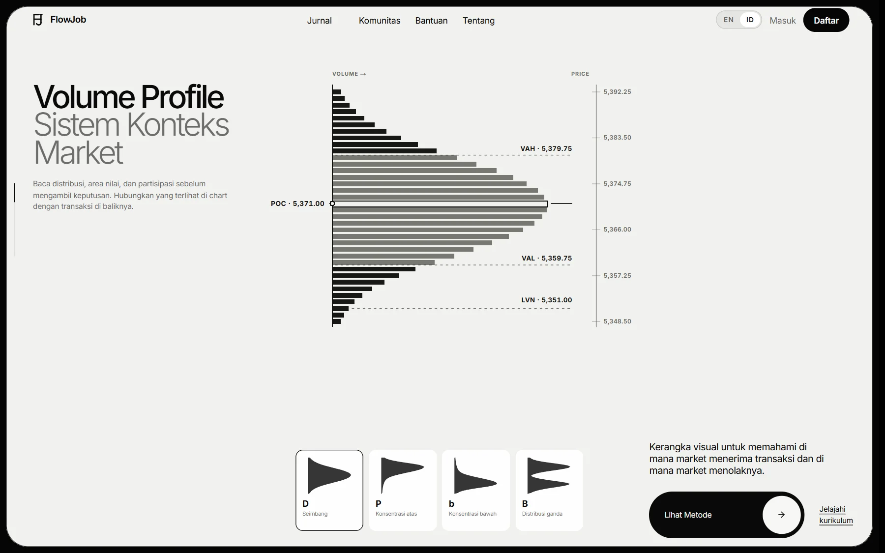

# FlowJob

**Trading Journal dan jalur belajar trading untuk pengguna Indonesia.**

[Website FlowJob](https://www.flowjob.id/)

FlowJob membantu trader mendokumentasikan keputusan, bukan mencari sinyal. Trading Journal digunakan untuk mencatat dan meninjau aktivitas trading. Sisi edukasinya menyusun pembelajaran melalui empat perspektif: fondasi pasar, order flow, options flow, dan makro.

## Tampilan beranda

Cuplikan halaman publik tanpa login; tampilan produk dapat berubah.

## Gambaran produk

- **Trading Journal:** ruang untuk mencatat aktivitas dan meninjau keputusan trading.
- **Learning Path:** katalog silabus 28 bab dalam empat pilar; status penerbitan dan akses materi mengikuti informasi terbaru di website.
- **Komunitas:** akses komunitas terhubung dengan akun FlowJob.
- **Dua bahasa:** metadata silabus tersedia dalam bahasa Indonesia dan Inggris.

## Pertimbangan produk

FlowJob memisahkan katalog silabus dari materi yang sudah dapat dibaca agar rencana pembelajaran tidak disalahartikan sebagai akses yang sudah tersedia. Dalam pengalaman journal, konteks, bukti, keputusan, dan ulasan ditempatkan sebagai bagian dari proses belajar mandiri.

## Coba produknya

Kunjungi [flowjob.id](https://www.flowjob.id/) untuk melihat beranda dan katalog. Fitur yang memerlukan akun mengikuti aturan akses di situs tersebut. FlowJob bukan layanan sinyal maupun nasihat keuangan; perdagangan futures memiliki risiko kerugian.

## Tentang repositori ini

Repositori ini hanya berisi dokumentasi portofolio dan screenshot halaman publik. Source code aplikasi, konfigurasi deployment, data pengguna, credential, dan riwayat pengembangan internal tidak dipublikasikan. Tidak ada instruksi menjalankan aplikasi dari repositori ini.

© 2026 FlowJob. All rights reserved.
