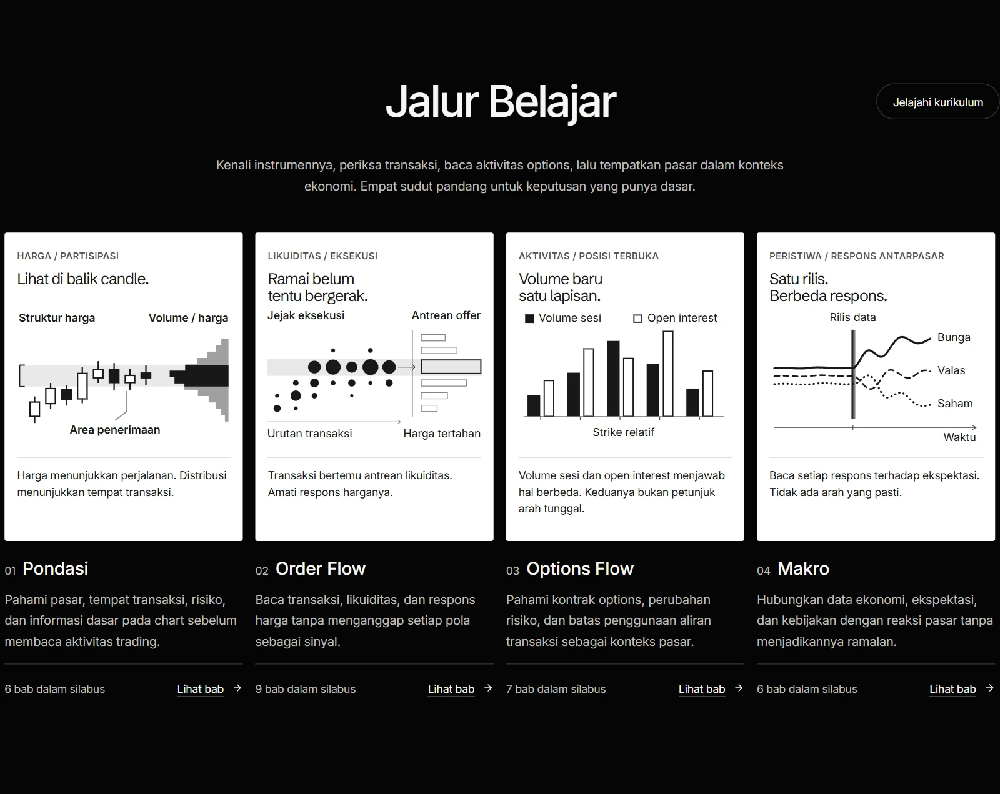
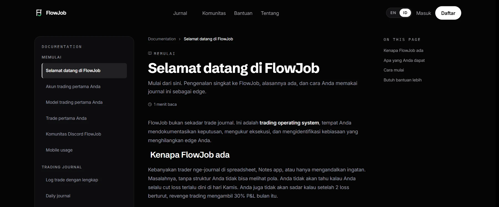
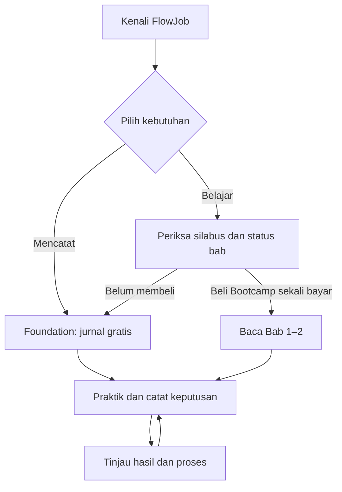

# FlowJob

**Bootcamp edukasi futures dengan Trading Journal untuk mencatat dan meninjau keputusan.**

FlowJob membantu pembelajar memahami apa yang diperdagangkan, bagaimana transaksi terbentuk, dan cara menilai bukti sebelum mengambil keputusan. Bootcamp menyusun pembelajaran melalui empat pilar; Trading Journal memberi tempat untuk mendokumentasikan rencana, transaksi, dan evaluasi. Keduanya saling melengkapi, tetapi jurnal dasar dapat digunakan tanpa membeli Bootcamp.

Saya membangun FlowJob sebagai **Founder & Solo Developer**, dari arah produk dan struktur pembelajaran hingga pengalaman aplikasi berbasis akun.

[Kunjungi FlowJob](https://www.flowjob.id/) · [Lihat jalur belajar](https://www.flowjob.id/?lang=id#curriculum) · [Baca panduan jurnal](https://www.flowjob.id/docs/welcome?lang=id)

## Mengapa FlowJob ada

Grafik menunjukkan hasil pergerakan harga, tetapi tidak selalu menjelaskan transaksi di baliknya. Sebaliknya, catatan untung-rugi tidak menjelaskan apakah sebuah keputusan dibuat dengan alasan yang dapat dipertanggungjawabkan. FlowJob menyatukan dua kebutuhan yang sering terpisah: **belajar membaca konteks pasar** dan **meninjau keputusan sendiri secara terstruktur**.

Pendekatannya berangkat dari empat pertanyaan: apa konteks pasar, di mana area yang relevan, bukti apa yang terlihat pada transaksi dan respons harga, serta apa yang perlu dicatat setelah keputusan dibuat. Ini kerangka belajar dan evaluasi, bukan metode pemberian sinyal.

## Apa yang ditawarkan

### Bootcamp: belajar membaca pasar

Jalur belajar disusun dalam **28 bab silabus** pada empat pilar:

| Pilar | Cakupan pembelajaran | Bab dalam silabus |
| --- | --- | ---: |
| **Pondasi** | Instrumen, tempat transaksi, risiko, dan dasar pembacaan chart. | 6 |
| **Order Flow** | Transaksi, likuiditas, dan respons harga. | 9 |
| **Options Flow** | Kontrak options, perubahan risiko, dan batas interpretasi aktivitas options. | 7 |
| **Makro** | Data ekonomi, ekspektasi, kebijakan, dan reaksi antarpasar. | 6 |

**Yang tersedia saat peninjauan (7 November 2026):** [halaman Tentang FlowJob](https://www.flowjob.id/about) menyatakan **Bab 1 dan 2 dapat dibaca dengan akses Bootcamp; 26 bab lainnya masih direncanakan**. Bab 1 membahas pasar dan cara kerjanya; Bab 2 membedakan bursa, OTC, CEX, dan DEX. Angka 28 adalah cakupan silabus, bukan jumlah materi yang sudah terbit. Materi lama tidak lagi tersedia. Periksa status dan hak akses terbaru di website sebelum membeli.

Bootcamp dibeli **sekali bayar**. Harga yang ditampilkan di beranda saat peninjauan adalah **Rp3.500.000**; harga akhir dan ketentuan mengikuti halaman pembelian. Broker, data pasar, platform pihak ketiga, dan modal trading tidak termasuk. FlowJob tidak menjanjikan kelas live, pendampingan pribadi, sertifikasi, atau tanggal terbit bagi bab yang masih direncanakan.

### Trading Journal: menilai praktik sendiri

**Foundation** memberi akses gratis ke jurnal dasar. Pengguna dapat memisahkan catatan Live dan Forward Test melalui akun pencatatan, menulis aturan setup pada Model, mencatat trade beserta risiko dan alasan eksekusinya, lalu menulis rencana dan evaluasi harian. Analytics membantu membaca pola dari riwayat yang diisi pengguna; ia tidak memutuskan apakah sebuah trade layak diambil.

Jurnal adalah alat pencatatan, **bukan rekening broker**: membuat akun pencatatan tidak membuka rekening transaksi atau mengirim order. Rincian alurnya ada di [panduan akun](https://www.flowjob.id/docs/getting-started/your-first-account), [trade pertama](https://www.flowjob.id/docs/getting-started/your-first-trade), dan [Analytics](https://www.flowjob.id/docs/analytics/overview).

## Perjalanan pengguna

Foundation dapat digunakan tanpa Bootcamp. Jalur berbayar menambah akses ke bab yang sudah terbit, bukan otomatis ke seluruh 28 bab silabus.

## Keputusan produk

**Pisahkan silabus dari inventaris materi.** Empat pilar memperlihatkan arah belajar, tetapi status setiap bab harus tetap jelas sebelum pembelian. Menampilkan 28 judul tanpa membedakan bab terbit akan menciptakan ekspektasi yang keliru.

**Pisahkan hasil dari kualitas keputusan.** Trade yang untung belum tentu mengikuti rencana; trade yang rugi belum tentu keliru dalam prosesnya. Karena itu jurnal menghubungkan akun, model, rincian transaksi, dan catatan harian sebelum hasilnya ditinjau melalui Analytics.

**Jaga batas antara edukasi dan eksekusi.** Contoh pasar menjelaskan cara membaca informasi; jurnal merekam keputusan pengguna. FlowJob tidak menyediakan sinyal, copy trading, pengelolaan dana, atau rekomendasi transaksi personal.

## Sumber dan batas studi kasus

- [Beranda FlowJob](https://www.flowjob.id/) — metode, empat pilar, penawaran, dan biaya di luar produk.
- [Tentang FlowJob](https://www.flowjob.id/about) — akses Foundation serta status materi Bootcamp.
- [Dokumentasi pengguna](https://www.flowjob.id/docs/welcome?lang=id) — fungsi dan urutan penggunaan Trading Journal.
- [Syarat dan Ketentuan](https://www.flowjob.id/terms) — produk, pembayaran, refund, dan batas edukasi.

Gambar berasal dari halaman publik tanpa login pada 7 November 2026 (WIB); studi kasus ini tidak menampilkan materi anggota atau data jurnal pengguna. Repositori ini berisi uraian produk, bukan kode aplikasinya. Perdagangan futures dan derivatif berisiko; materi FlowJob bukan nasihat keuangan.

© 2026 FlowJob. All rights reserved.
